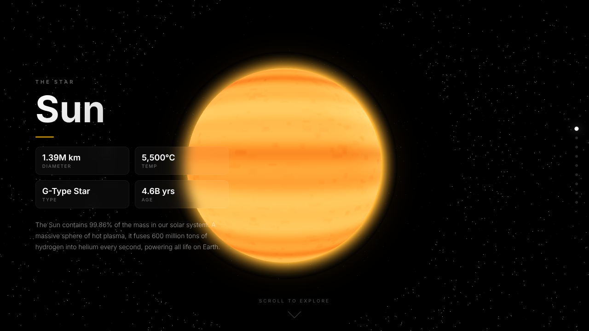
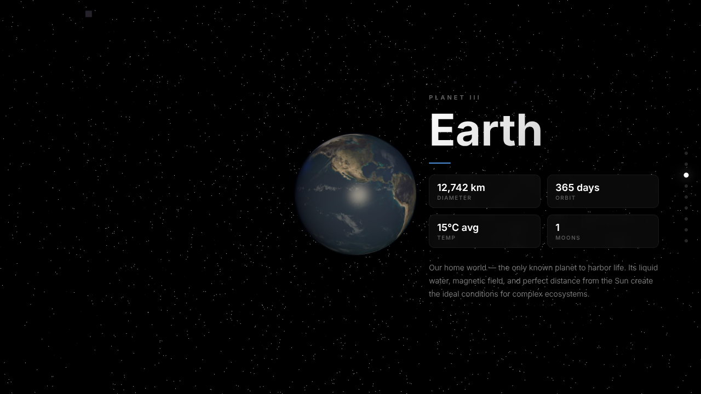
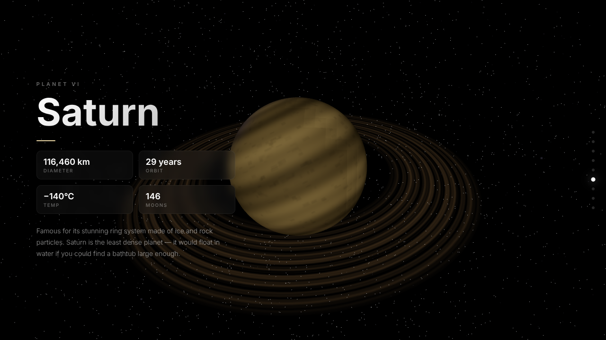
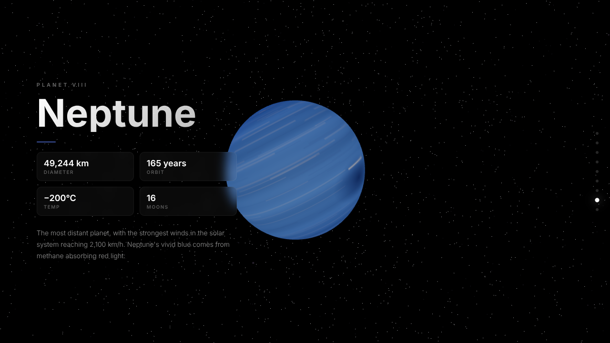

# 🌌 Solar System Explorer

Solar System Explorer is an interactive 3D website that takes you on a scroll-driven journey from the Sun to Neptune. Each planet is a textured 3D model with glowing atmospheres and rings, paired with an info panel showing its size, orbit, temperature and moons. Built with HTML, CSS, JavaScript and Three.js.



## ✨ Features

- **Scroll-driven camera:** the camera flies smoothly from planet to planet as you scroll
- **9 celestial bodies:** the Sun and all eight planets, from Mercury to Neptune
- **Realistic rendering:** planet textures, Earth's normal/specular maps and cloud layer, glowing atmospheres, and a corona around the Sun
- **Procedural details:** Saturn's and Uranus's rings, plus the Uranus and Neptune surfaces, are drawn in code
- **Info panels:** diameter, orbit, temperature, moons and a short fact about each planet
- **Starfield background:** 20,000 stars plus a soft nebula dust layer
- **Fast and reliable loading:** textures download in parallel, and any image that fails falls back to a drawn texture, so the page never gets stuck
- **Responsive:** works on desktop and mobile screens

## 📸 Screenshots

| Earth | Saturn |
|---|---|
|  |  |

| Neptune |
|---|
|  |

## 🛠️ Tech Stack

- **HTML5:** page structure
- **CSS3:** layout, glassmorphism info panels, animations
- **JavaScript (ES6+):** scroll logic and scene setup
- **[Three.js](https://threejs.org/) r170:** 3D rendering (WebGL), loaded from a CDN

## 📁 Project Structure

```
Solar Project/
├── index.html        # Page structure
├── css/
│   └── style.css     # All styles
├── js/
│   └── main.js       # Three.js scene, planets, scroll animation
└── screenshots/      # Images used in this README
```

## 🚀 How to Run

1. Clone the repository
   ```bash
   git clone https://github.com/Adityak0012/Solar-System-Explorer.git
   ```
2. Open `index.html` in a modern browser (Chrome, Edge or Firefox)

That's it. No build step or installation is needed. An internet connection is required to load Three.js and the planet textures.

> Tip: you can also serve it locally with the VS Code **Live Server** extension.

## 🙏 Credits

- Planet images: NASA imagery via [Wikimedia Commons](https://commons.wikimedia.org/)
- Earth textures: [three.js examples](https://github.com/mrdoob/three.js/tree/dev/examples/textures/planets)
- 3D engine: [Three.js](https://threejs.org/)

## 👤 Author

**Aditya Kale**
- GitHub: [@Adityak0012](https://github.com/Adityak0012)
- LinkedIn: [adityak0012](https://www.linkedin.com/in/adityak0012)
